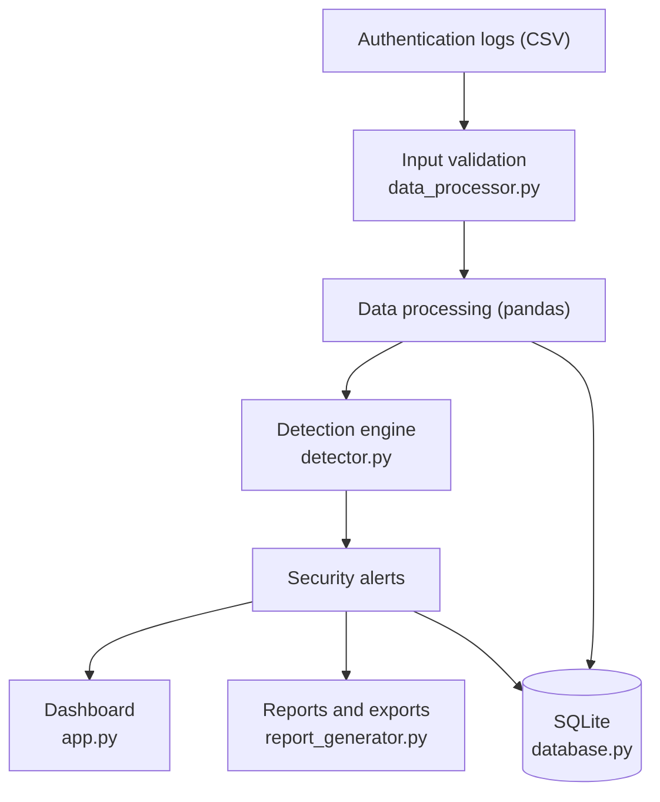

# CyberShield: Intelligent Threat Detection and Security Monitoring Dashboard

A SIEM-inspired web dashboard, built in Python, that reads authentication logs, flags suspicious login patterns with explainable rules, and presents alerts, charts and reports.

> **Demonstration project.** It uses fictional, simulated data by default. It is not a production security monitoring system.

**Live demo:** `<add your Streamlit link here after deploying>`

## Problem statement
Authentication logs are long and repetitive. Patterns such as many failed logins from one address are easy to miss by eye. Security teams use SIEM tools to turn raw logs into prioritised, explainable alerts. CyberShield is a small, readable version of that idea.

## Objectives
- Load and strictly validate authentication logs (CSV).
- Detect suspicious patterns with configurable, testable rules.
- Explain every alert and separate observed facts from suspicion.
- Let an analyst filter alerts, mark them reviewed, and export reports.

## Key features
- Dark, responsive dashboard: summary cards, 6 interactive charts, searchable event table, alert panels, incident timeline.
- 5 detection rules with LOW / MEDIUM / HIGH / CRITICAL severity and adjustable thresholds.
- CSV upload with validation (columns, timestamps, IPs, statuses, size, malformed lines); rejected rows are shown with reasons.
- Alert review status saved in SQLite, with duplicate-safe imports.
- Downloadable Markdown incident report and CSV exports (protected against spreadsheet formula injection).
- Automated tests run by GitHub Actions.

## Architecture


## Technology stack
Python 3.12, Streamlit, pandas, Plotly, SQLite (standard library), pytest, GitHub Actions, Streamlit Community Cloud.

## Repository structure
```
CyberShield/
├── app.py                 Streamlit dashboard (screen only)
├── data_processor.py      CSV loading and validation
├── detector.py            Detection rules and sliding-window algorithm
├── database.py            All SQLite code
├── report_generator.py    Incident report and safe CSV export
├── conftest.py            Lets pytest find the modules
├── requirements.txt
├── data/
│   ├── sample_logs.csv    Simulated logs (event IDs start with SIM-)
│   └── README.md
├── tests/
│   ├── test_data_processor.py
│   ├── test_detector.py
│   ├── test_database.py
│   └── test_report_generator.py
├── screenshots/README.md
├── .streamlit/config.toml
└── .github/workflows/tests.yml
```

## Run it
You need Python 3.12.
```bash
pip install -r requirements.txt
streamlit run app.py
```

## Run the tests
From the repository root:
```bash
pip install pytest
python -m pytest -v
```
The tests also run automatically on GitHub (Actions tab) after every commit.

## Deployment
1. Push the repository to GitHub.
2. On Streamlit Community Cloud choose **Create app**, select this repository, branch `main`, main file `app.py`.
3. Open **Advanced settings** and choose **Python 3.12**.
4. No secrets are needed. Do not add any.

## Sample data
`data/sample_logs.csv` has 75 simulated records. They include normal activity, a brute-force burst, a burst followed by a successful login, password spraying, a harmless backup script that still triggers an alert (a deliberate false positive), a near miss, slow failures, and 3 deliberately malformed rows. See `data/README.md`.

## Detection algorithm
For each IP address, events are sorted by time and a sliding window moves across them. A window qualifies when it holds at least N events (and, for the username rule, at least N different usernames). Overlapping qualifying windows are merged, so one burst produces one alert and no event is counted twice. Every event enters and leaves the window once, so the work grows linearly with the data. A window includes its boundary: first and last events exactly 5 minutes apart still count.

## Detection rules
| Rule | Fires when (defaults) | Severity |
|---|---|---|
| Repeated failed logins | 5+ failures from one IP within 5 min | MEDIUM at 5, HIGH at 10, CRITICAL at 20 |
| Multiple usernames from one IP | 5+ usernames failing from one IP within 10 min | MEDIUM at 5, HIGH at 10 |
| Success after repeated failures | Success from an IP with 5+ failures in the previous 10 min | MEDIUM (other user), HIGH (same user), CRITICAL (same user and 10+ failures) |
| High login activity | 10+ attempts of any kind from one IP within 1 min | LOW at 10, MEDIUM at 20, HIGH at 40 |
| Malformed records | Some rows were rejected during validation | LOW under 10%, MEDIUM from 10%, HIGH from 50% |

All thresholds and windows can be changed in the sidebar. Every rule is a heuristic. A rule firing does not prove malicious intent.

## Screenshots
Screenshots will be added in the `screenshots/` folder. See `screenshots/README.md` for the list.

## Security and privacy
- Fictional data only. No real passwords or secrets are collected or stored.
- Uploaded files are parsed as data and never executed. Size, row count, encoding, column names, timestamps, IPs and statuses are validated.
- All SQL uses parameter placeholders. User text shown as HTML is escaped. CSV exports neutralise formulas.
- Users see generic error messages, not stack traces.
- IP addresses are treated as indicators, not proof of identity. Private or unfamiliar addresses are never flagged for that reason alone.
- On free hosting, storage can be temporary and shared. Do not upload real logs.

## Known limitations
- Rule-based heuristics only: expect false positives and false negatives.
- Simulated data is cleaner and smaller than real logs.
- Batch analysis of uploaded files, not real-time collection.
- No user accounts or access control. The database is shared by all visitors on a public deployment.
- No PDF export.
- Time zones: times without an offset are treated as UTC.

## Demonstration project vs production system
A production system would collect logs continuously from many sources, store them at scale, authenticate analysts, protect the logs from tampering, tune rules against real traffic, correlate with other data (VPN, firewall, threat intelligence), and notify people. CyberShield demonstrates the core idea only.

## Future improvements
Per-user baselines, offline IP enrichment, user accounts with separate storage, notification export, PDF reports, evaluated anomaly detection once suitable labelled data exists.

## Author
- Name: ANOOJ KRISHNA A K
- Course: Diploma in Computer Engineering,GPC CHERTHALA
- LinkedIn: https://www.linkedin.com/in/anooj-krishna-a-k-146038382?utm_source=share_via&utm_content=profile&utm_medium=member_android
- Email: anoojkrishnaak@gmail.com
